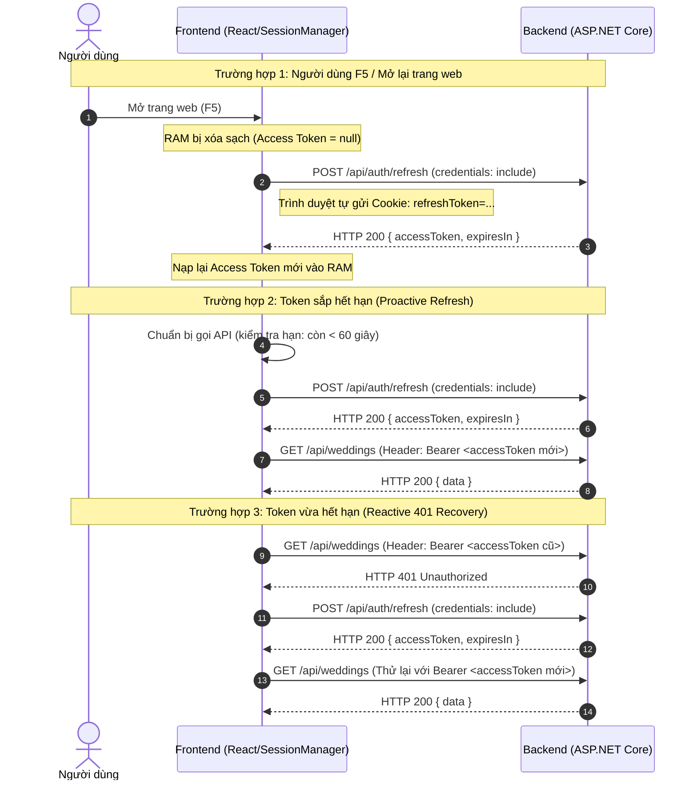

# Hướng dẫn chi tiết Kiến trúc Authentication & Authorization (Dành cho Backend Developer)

> **Mục tiêu tài liệu**: Giải thích toàn bộ cơ chế đăng nhập, lưu trữ token, tự động làm mới (refresh token), bảo vệ route và phân quyền trên Frontend (Next.js/React) theo cách tiếp cận dễ hiểu nhất cho lập trình viên Backend (.NET / ASP.NET Core).

---

## 1. Bức tranh tổng quan (High-Level Architecture)

Trong các ứng dụng Web hiện đại, sự kết hợp giữa **Next.js (Frontend)** và **ASP.NET Core Web API (Backend)** thường sử dụng mô hình **Bảo mật kép (Hybrid Token Storage)**:

```
┌────────────────────────────────────────────────────────┐
│                   TRÌNH DUYỆT (BROWSER)                │
│                                                        │
│   ┌──────────────────────────┐    ┌────────────────┐  │
│   │   JavaScript Memory      │    │  Cookie Jar    │  │
│   │   (SessionManager)       │    │  (Trình duyệt) │  │
│   │                          │    │                │  │
│   │   ► Access Token (JWT)   │    │  ► Refresh     │  │
│   │     Sống ngắn (15 phút)  │    │    Token       │  │
│   │     Lưu trong RAM        │    │    (HttpOnly)  │  │
│   └─────────────┬────────────┘    └───────┬────────┘  │
└─────────────────┼─────────────────────────┼───────────┘
                  │                         │
     Header: Bearer <JWT>       Cookie: refreshToken=...
     (Cho các API nghiệp vụ)    (credentials: "include")
                  │                         │
                  ▼                         ▼
┌────────────────────────────────────────────────────────┐
│              ASP.NET CORE BACKEND API                  │
│                                                        │
│   • Validate JWT Bearer      • Endpoints:              │
│   • Enforce Role & Policies    /api/auth/login         │
│   • Map Claims to User         /api/auth/refresh       │
│                                /api/auth/logout        │
└────────────────────────────────────────────────────────┘
```

---

## 2. Token lưu ở đâu? Tại sao không dùng localStorage?

### 2.1. So sánh các nơi lưu trữ

| Nơi lưu trữ                                                   | Rủi ro bảo mật                         | Đặc điểm trên Frontend                                                                                                                                                                                                               | Đánh giá                                |
| :------------------------------------------------------------ | :------------------------------------- | :----------------------------------------------------------------------------------------------------------------------------------------------------------------------------------------------------------------------------------- | :-------------------------------------- |
| **`localStorage` / `sessionStorage`**                         | **CỰC KỲ NGUY HIỂM (XSS)**             | Bất kỳ đoạn mã JavaScript độc hại nào (từ thư viện bên thứ 3 npm bị cài cắm mã độc) đều đọc được qua `localStorage.getItem("token")` và gửi về server hacker.                                                                        | ❌ Không dùng cho ứng dụng doanh nghiệp |
| **`HttpOnly Cookie` (cho Access Token)**                      | **Khó xử lý SignalR & Cross-Domain**   | JavaScript không đọc được. Tuy nhiên, gửi cookie kèm mọi request dễ dính lỗ hổng CSRF và phức tạp khi làm việc với WebSocket/SignalR Hub.                                                                                            | ⚠️ Không tối ưu cho Access Token        |
| **`In-Memory (RAM)` + `HttpOnly Cookie` (Mô hình đang dùng)** | **An toàn nhất (Best Practice OWASP)** | • **Access Token** lưu trong RAM: Hacker dính XSS cũng không thể gọi `localStorage` để lấy trộm token lâu dài.<br>• **Refresh Token** lưu trong HttpOnly Cookie: Trình duyệt tự đính kèm khi gọi `/refresh`, JS không chạm vào được. | **Được khuyến nghị**                    |

### 2.2. Chi tiết lưu trữ trong code:

- **Access Token**: Nằm bên trong biến `private token: SessionToken | null` của class [`SessionManager`](file:///c:/Project/CapstoneBE/InviteMe-Frontend/src/core/auth/session-manager.ts). Nó tương tự như một `Singleton Service` hoặc `Scoped Service` giữ biến trong bộ nhớ RAM của ứng dụng.
- **Refresh Token**: Do ASP.NET Backend phát hành qua header HTTP Response:
  ```http
  Set-Cookie: refreshToken=abc123xyz...; Path=/api/auth; HttpOnly; Secure; SameSite=Lax; Max-Age=604800
  ```
  Frontend **không hề đọc, không hề parse** chuỗi này. Trình duyệt tự động cất vào "két sắt" (Cookie Jar) và tự động đính kèm khi gọi API đến domain của backend.

---

## 3. Khi nào Refresh Token? Cơ chế hoạt động ra sao?

Có 3 trường hợp cần làm mới Access Token:



### Chi tiết kỹ thuật:

1. **Khôi phục khi F5 (`session.restore()`)**:
   - Khi user bấm F5, bộ nhớ JavaScript bị reset sạch (Access Token trở về `null`).
   - [`Providers`](file:///c:/Project/CapstoneBE/InviteMe-Frontend/src/app/providers.tsx) khi vừa mount sẽ lập tức gọi `runtime.session.restore()`.
   - Trong thời gian này, [`AuthGuard`](file:///c:/Project/CapstoneBE/InviteMe-Frontend/src/features/auth/components/auth-guard.tsx) kiểm tra cờ `isRestored`: Nếu chưa khôi phục xong thì hiển thị màn hình chờ (Loading spinner), **tuyệt đối không đá người dùng ra trang login**.
2. **Làm mới chủ động (Proactive Refresh)**:
   - Trong `SessionManager.getToken()`: Nếu token còn hiệu lực dưới 60 giây, hàm sẽ chủ động gọi refresh trước khi trả token cho request, tránh tình trạng request gửi đi bị backend từ chối.
3. **Phục hồi tự động (401 Retry)**:
   - Trong [`ApiClient.request()`](file:///c:/Project/CapstoneBE/InviteMe-Frontend/src/core/api/api-client.ts): Nếu backend trả về HTTP 401, client sẽ thử `session.recover()` một lần duy nhất, lấy token mới và bắn lại request ban đầu. Nếu vẫn thất bại thì mới xóa phiên và yêu cầu đăng nhập lại.
4. **Chống nghẽn nhiều request đồng thời (Locking/Concurrency)**:
   - Nếu có 5 API cùng gửi đi khi token hết hạn, `SessionManager` lưu trữ một `refreshPromise`. Cả 5 request sẽ **dùng chung một Promise refresh duy nhất**, không bao giờ bắn 5 request refresh cùng lúc lên server.

---

## 4. Quản lý trạng thái phiên (Session Management)

### 4.1. Khái niệm `Generation` (Chống Race Condition)

Lập trình viên backend quen thuộc với `CancellationToken`. Trên Frontend, khái niệm tương đương là **`generation`**:

- Mỗi khi user đăng nhập, đăng xuất hoặc đổi tài khoản, số `generation` tăng lên 1 đơn vị.
- Nếu một request API của tài khoản cũ chạy chậm và trả về kết quả sau khi user đã bấm Logout, Frontend so sánh `generation` và hủy bỏ (abort) ngay lập tức, ngăn chặn dữ liệu của tài khoản cũ hiển thị nhầm vào màn hình tài khoản mới.

### 4.2. Khái niệm `useSyncExternalStore` (Đồng bộ Reactive)

`SessionManager` là một lớp TypeScript thuần túy (không phụ thuộc React UI). Để React Component biết được khi nào có token mới mà không cần re-render toàn bộ ứng dụng, hook [`useCurrentUser`](file:///c:/Project/CapstoneBE/InviteMe-Frontend/src/features/auth/hooks/use-current-user.ts) sử dụng hàm chuẩn của React 18/19: `useSyncExternalStore`.

- Khi `session.setToken()` -> gọi `emit()` -> React component tự động cập nhật ngay lập tức.

---

## 5. Phân quyền và Bảo vệ Route (Authorization & Guards)

### 5.1. AuthGuard hoạt động như thế nào?

File: [`src/features/auth/components/auth-guard.tsx`](file:///c:/Project/CapstoneBE/InviteMe-Frontend/src/features/auth/components/auth-guard.tsx)

```tsx
<AuthGuard role="ADMIN">
  <AdminDashboard />
</AuthGuard>
```

Luồng kiểm tra của `AuthGuard`:

1. **Kiểm tra `isRestored`**: Nếu đang restore phiên sau F5 -> Hiển thị Loading State.
2. **Kiểm tra `isAuthenticated`**: Nếu không có token -> `router.replace('/login?returnTo=' + currentUrl)`.
3. **Kiểm tra `role`**: Nếu route yêu cầu `ADMIN` mà tài khoản có `role === "USER"` -> Chuyển hướng về `/dashboard` (không cho xem trang Admin).
4. **Hợp lệ**: Render giao diện con (`children`).

> ⚠️ **Lưu ý quan trọng cho Backend**:
> `AuthGuard` trên Frontend chỉ đóng vai trò **điều hướng UX** (giúp người dùng không thấy giao diện họ không có quyền).
> **Bức tường bảo mật thực sự vẫn là Backend ASP.NET Core** với các filter:
> `[Authorize(Roles = "ADMIN")]` hoặc `.RequireAuthorization()`.

---

## 6. Hướng dẫn Setup & Cấu hình môi trường

### 6.1. Cấu hình Frontend

File: `.env.local`

```env
# URL trỏ tới ASP.NET Backend API
NEXT_PUBLIC_API_URL=http://localhost:5000/api

# URL trỏ tới SignalR Hub (nếu dùng)
NEXT_PUBLIC_SIGNALR_URL=http://localhost:5000/hubs/wedding

# Google Client ID (lấy từ Google Cloud Console)
NEXT_PUBLIC_GOOGLE_CLIENT_ID=1234567890-abcdef.apps.googleusercontent.com
```

### 6.2. Cấu hình Backend ASP.NET Core (Cực kỳ quan trọng!)

Để mô hình cookie và token hoạt động, Backend ASP.NET Core cần đảm bảo:

1. **CORS Policy (Bắt buộc cho phép Credentials)**:

   ```csharp
   builder.Services.AddCors(options =>
   {
       options.AddPolicy("FrontendOrigin", policy =>
       {
           policy.WithOrigins("http://localhost:3000") // Tuyệt đối KHÔNG dùng AllowAnyOrigin() / "*"
                 .AllowAnyHeader()
                 .AllowAnyMethod()
                 .AllowCredentials(); // Bắt buộc để trình duyệt gửi/nhận cookie
       });
   });
   ```

2. **Cấu hình Cookie khi Set Refresh Token**:

   ```csharp
   context.Response.Cookies.Append("refreshToken", tokenValue, new CookieOptions
   {
       HttpOnly = true, // Chặn JS đọc cookie
       Secure = true,   // Yêu cầu HTTPS (localhost chấp nhận)
       SameSite = SameSiteMode.Lax, // Hoặc None nếu khác domain production
       Path = "/api/auth",
       Expires = DateTimeOffset.UtcNow.AddDays(7)
   });
   ```

3. **Cấu hình Google Console**:
   - Truy cập **Google Cloud Console** > **APIs & Services** > **Credentials**.
   - Tạo **OAuth 2.0 Client ID** loại **Web Application**.
   - Mục **Authorized JavaScript origins**: Điền `http://localhost:3000` (và domain production).
   - Copy Client ID dán vào `NEXT_PUBLIC_GOOGLE_CLIENT_ID`.

---

## 7. Bảng so sánh thuật ngữ Backend (ASP.NET) và Frontend (Next.js)

| Khái niệm Backend (ASP.NET Core)  | Khái niệm tương đương Frontend (React/Next.js) | Giải thích                                                |
| :-------------------------------- | :--------------------------------------------- | :-------------------------------------------------------- |
| `HttpContext.User`                | `useCurrentUser()`                             | Lấy danh tính và thông tin người dùng đang đăng nhập      |
| `IAuthenticationService`          | `SessionManager`                               | Nơi quản lý vòng đời xác thực, lưu token                  |
| `[Authorize]` filter / middleware | `<AuthGuard>`                                  | Chặn người chưa đăng nhập truy cập route                  |
| `CancellationToken`               | `generation` / `AbortController`               | Hủy các tác vụ/request lỗi thời khi ngữ cảnh thay đổi     |
| `IMemoryCache` (Scoped/Singleton) | Biến private trong `SessionManager`            | Lưu trữ dữ liệu tạm thời trong RAM, mất khi khởi động lại |
| `IDistributedCache` / Database    | Trình duyệt Cookie Jar (HttpOnly)              | Lưu trữ bền vững xuyên suốt các lần F5/đóng tab           |
